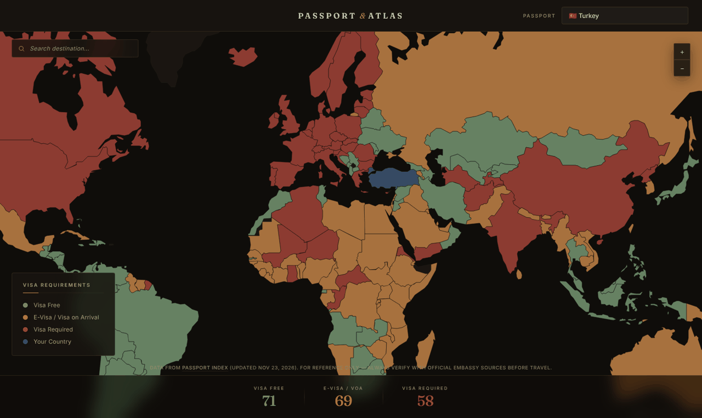
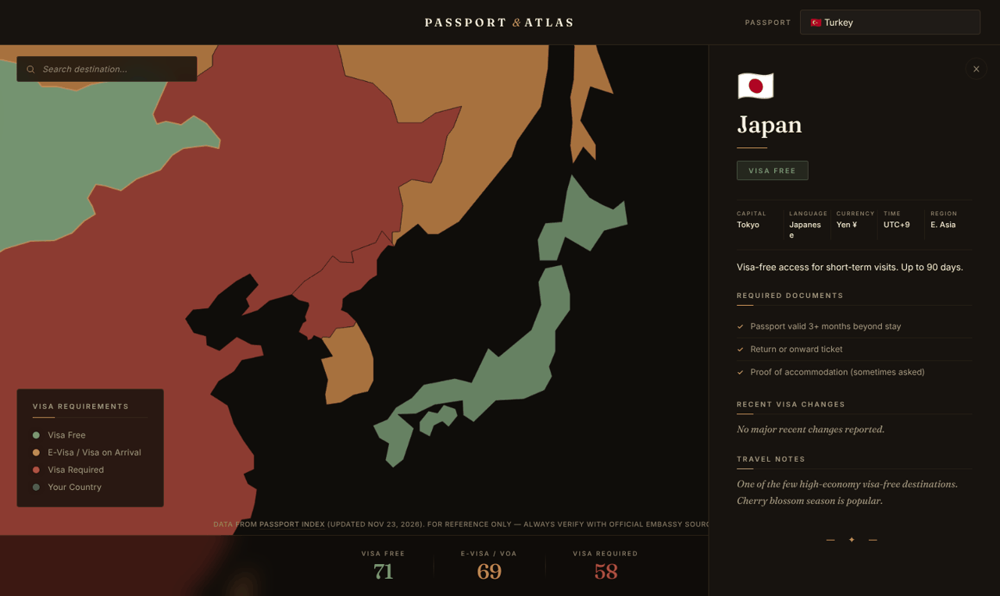
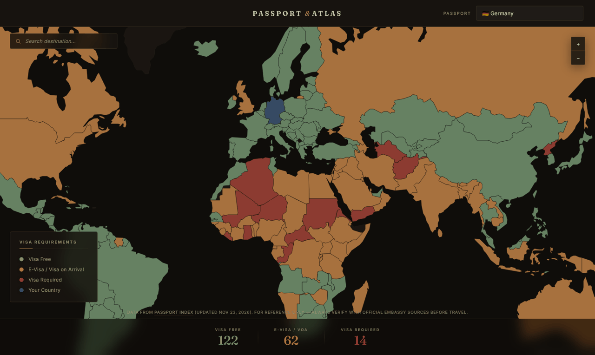
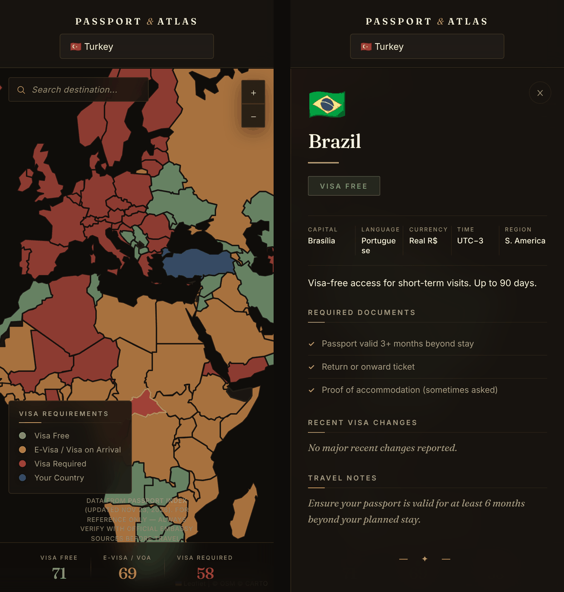
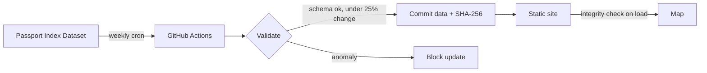

<div align="center">


# Passport & Atlas

**Where will your passport take you?**

An interactive world map that shows visa requirements for any passport.
Pick your passport and every destination lights up: visa-free, e-visa / visa on arrival, or visa required.

[](https://github.com/Berkin62232001/passport-visa-checker/actions/workflows/update-visa-data.yml)


[](LICENSE)

**Live demo:** _coming soon_

<br>


<sub>Choose a passport → the map recolors → search a destination → read the details.</sub>

</div>

---

## Gallery

<table>
  <tr>
    <td width="50%" align="center">
      <a href="docs/screenshots/welcome.png"></a>
      <br><sub><b>Welcome:</b> pick the passport you carry</sub>
    </td>
    <td width="50%" align="center">
      <a href="docs/screenshots/map-turkey.png"></a>
      <br><sub><b>Color-coded map:</b> Turkish passport with live stats</sub>
    </td>
  </tr>
  <tr>
    <td width="50%" align="center">
      <a href="docs/screenshots/info-panel.png"></a>
      <br><sub><b>Destination panel:</b> status, stay length, documents, tips</sub>
    </td>
    <td width="50%" align="center">
      <a href="docs/screenshots/map-germany.png"></a>
      <br><sub><b>Switch passports:</b> German passport, 122 visa-free</sub>
    </td>
  </tr>
</table>

<details>
<summary><b>📱 Mobile view</b> (click to expand)</summary>
<br>
<div align="center">
  
</div>
</details>

<sub>Click any screenshot to open it at full size.</sub>

---

## Features

| | |
|---|---|
| 🛂 **199 passports** | Select any passport and see requirements for every destination |
| 🗺️ **Color-coded map** | 🟢 visa-free · 🟠 e-visa / visa on arrival · 🔴 visa required · 🔵 your country |
| 📋 **Destination panel** | Click a country for visa status, allowed stay, required documents, recent policy changes, and travel tips |
| 📊 **Live stats bar** | Visa-free, e-visa and visa-required counts update as you switch passports |
| 🔎 **Autocomplete search** | Find a passport or jump straight to a destination |
| 📱 **Responsive** | Works on desktop and mobile, installable as a PWA |
| 🌙 **Dark theme** | Warm atlas palette with smooth animations |

---

## How the data stays fresh

Visa data comes from the open-source [Passport Index Dataset](https://github.com/imorte/passport-index-data) (MIT) and is refreshed every Monday by GitHub Actions.



- Every update is checked for **schema correctness** and **anomalies** before it is committed
- **SHA-256 integrity checks** catch accidental corruption
- A **staleness warning** appears if the data is older than 60 days

> [!WARNING]
> Visa rules change often. Always confirm with the official embassy or consulate before you travel.

---

## Run locally

Use a local server. Opening `index.html` as `file://` does not work, because browsers block `fetch()` from reading local JSON files.

```bash
npm install
npm run dev
```

Then open the localhost URL printed in the terminal.

---

## Tech stack

- **Pure HTML / CSS / JavaScript**: no frameworks, no build step
- **Leaflet.js**: map rendering
- **TopoJSON** (world-atlas): lightweight country boundaries, vendored locally
- **GitHub Actions**: automated data pipeline
- **Netlify-style `_headers`**: security headers for static hosting

<details>
<summary><b>📁 Project structure</b></summary>

```
.
├── index.html                          # Main page
├── favicon.svg                         # Brand mark (gold compass on dark)
├── site.webmanifest                    # PWA manifest
├── robots.txt / sitemap.xml            # SEO basics
├── css/style.css                       # Dark theme styles
├── js/
│   ├── app.js                          # Map logic, UI, interactions
│   ├── visa-data.js                    # COUNTRY_INFO (names + flags) + ENRICHMENT_DATA (per-route tips)
│   ├── country-facts.js                # COUNTRY_FACTS (capital/language/currency/timezone/region) + STATUS_TEMPLATES
│   ├── visa-data-loader.js             # Data loading with integrity checks
│   └── vendor/
│       └── topojson-client.min.js      # TopoJSON → GeoJSON (vendored, no CDN dep)
├── _headers                            # Security headers (CSP, X-Frame-Options, …)
├── data/
│   ├── passport-index-validated.json   # Validated visa data (auto-updated)
│   ├── countries-110m.json             # Vendored world-atlas map geometry
│   └── data-meta.json                  # Update metadata + SHA-256 hash
├── docs/screenshots/                   # README images
├── scripts/
│   └── validate-and-update-data.js     # Data validation pipeline
└── .github/workflows/
    └── update-visa-data.yml            # Weekly auto-update workflow
```

</details>

<details>
<summary><b>🔒 Security</b></summary>

- Content Security Policy (CSP) pinned to the exact external files used, delivered both as HTTP headers (`_headers`) and a `<meta>` fallback
- Clickjacking protection via `frame-ancestors` / `X-Frame-Options` headers
- Subresource Integrity (SRI) on CDN scripts
- Map geometry vendored locally (`data/countries-110m.json`), so no third-party CDN is needed at runtime (pinned jsDelivr mirror kept as fallback only)
- HTML escaping on all externally sourced data
- SHA-256 corruption detection on visa data files (HTTPS is the real trust boundary)
- Anomaly detection blocks suspicious data changes (>25% change threshold)
- No API keys, no secrets, no backend: fully static

</details>

---

## License

MIT © 2026 Berkin YILMAZ
